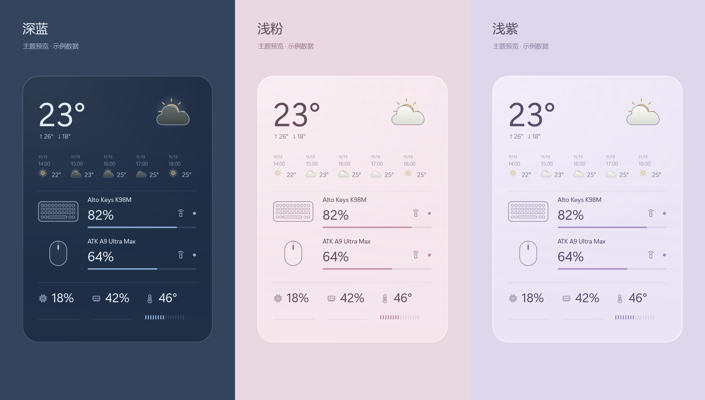

# Mizu

简约、可自定义的 Windows 桌面状态小组件：天气、键鼠电量、系统负载与待办。



*上图为实际 WPF 界面的渲染，指标使用示例数据。当前材质为半透明渐变，不提供实时背景模糊或光学折射。*

## 功能

- 获取冗余：天气主源 Open-Meteo → 备用 wttr.in → 本地缓存；诗词在线来源 + 联网缓存 + 30 条内置公版诗句。

- 每日诗词：单行诗句、右下出处、手动刷新、每日更新与 30 条内置公版兜底；设置菜单跟随五种主题即时换色。

- 网络：活动网卡上下行速率，最多 8 个自定义 IPv4 / IPv6 探测，各自统计延迟与最近 60 次 ICMP 丢包率；可隐藏 IP。
- 媒体：可选系统当前播放、上一首、播放 / 暂停和下一首（Windows 10 1809+）。

- 外设电量：自动识别蓝牙与部分 2.4G 接收器，区分键盘、鼠标，监听已配对蓝牙连接，自动优先显示新上线连接，保留离线旧读数。
- 系统状态：CPU / 内存负载、趋势图，可选 CPU 温度。
- 天气：当前、小时与多日预报自由组合，使用所选城市当地时间。
- 待办：本地保存，直接添加、勾选与编辑。
- 外观：五种主题，圆角、透明度、字号、字重与平滑缩放可调；悬停显示操作按钮。
- 提醒：可选 PushPlus 低电量与持续高负载 / 高温通知。

## 开始使用

当前版本 **0.5.0 预览版**。[下载安装版或便携版](https://github.com/cqc0101/Mizu/releases/tag/v0.5.0)。
安装版运行对应的 `-setup.exe`；便携版完整解压，双击根目录 `Mizu.exe`。[安装与卸载说明](docs/installation.md)
常见 Intel / AMD 电脑使用 `win-x64`；32 位 Windows 使用 `win-x86`；ARM 使用 `win-arm64`。
首次使用在设置中选择城市并调整显示内容。双击组件或按 `Ctrl+,` 打开设置；托盘菜单可退出。
更新前先退出旧版，再将新版解压到新文件夹；原设置会保留。

运行目标为 Windows 10 / 11，目前主要验证环境为本机 Windows x64。x86 版本已获用户验证可用反馈（2026-11-14），未记录其操作系统位数和专项测试范围；ARM64 和独立 32 位 Windows 仍待完整实机验证。
主程序随包携带 .NET 10，根启动器使用 Windows 内置 .NET Framework 4.x。
便携包的 `app` 文件夹需要完整保留。[完整使用说明](docs/usage.md)

## 设备支持

| 设备 / 数据来源 | 当前状态 |
| --- | --- |
| Logitech Alto Keys K98M + Bolt | 本机已读到真实电量与键盘类型 |
| ATK A9 Ultra Max 2.0 三模版 + 2.4G 接收器 | 本机已读到真实电量与鼠标类型 |
| ATK A9 Ultra Max 2.0 蓝牙 | 本机读到 75%，已捕获蓝牙 → 2.4G → 蓝牙的双向状态变化 |
| Windows 蓝牙电量、标准 HID BatteryStrength | 已实现，取决于设备是否上报以及系统缓存 |
| 其他 Logitech HID++、ATK / VXE 协议型号 | 已有协议实现或识别条目，需逐型号验证 |
| CPU 温度 | 可选 LHM + PawnIO；安装后的真实温度仍待实机验收 |

2.4G 电量没有统一的 Windows 接口。型号目录中的条目不代表全部实测兼容；没有读数时显示 `—`。
CPU 温度要求 x64 Windows 10 1809+ / Windows 11、支持的传感器与管理员权限；驱动由用户在设置中主动安装。
[支持范围与反馈方式](docs/devices.md) · [验证记录](docs/verification.md)

## 从源码构建

Windows 上安装 .NET 10 SDK；发布脚本使用 PowerShell 7（`pwsh`）。无需安装 Visual Studio。

```powershell
dotnet restore .\Mizu.slnx --configfile .\NuGet.Config --disable-parallel
dotnet build .\src\Mizu.Widget\Mizu.Widget.csproj -c Release --no-restore
dotnet run --project .\tests\Mizu.Tests\Mizu.Tests.csproj -c Release
dotnet run --project .\tests\Mizu.Widget.Checks\Mizu.Widget.Checks.csproj -c Release
pwsh .\scripts\publish.ps1 -Runtime win-x64
```

输出：`artifacts/Mizu-0.5.0-win-x64/`。其他可选目标：`win-x86`、`win-arm64`。
首次还原和跨架构发布需要访问 NuGet。WPF 检查需要交互式 Windows 桌面。
[架构与扩展](docs/architecture.md) · [参与贡献](CONTRIBUTING.md) · [版本记录](CHANGELOG.md)

## 数据与许可

设置、待办、电量缓存与日志存储在 `%LOCALAPPDATA%\Mizu`。PushPlus Token 使用当前 Windows 用户的 DPAPI 加密。
天气与推送按用户配置访问对应服务，无遥测或广告。温度驱动由用户主动安装，可能请求管理员授权。
[数据与权限说明](docs/privacy.md)

Mizu 自有源码使用 [MIT](LICENSE)；第三方库、驱动安装器与天气数据保留各自许可。
依赖、协议参考与署名见 [第三方声明](THIRD-PARTY-NOTICES.md)。Mizu 与设备厂商及设计参考品牌无隶属关系。
